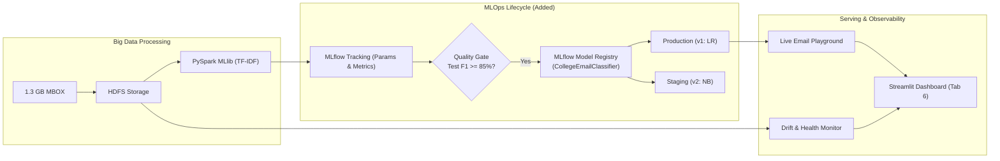

# Walkthrough: MLOps Integration (Level 1 + Level 2)

We have successfully integrated enterprise-grade **MLOps (Machine Learning Operations)** into the **Intelligent College Email Classification and Opportunity Analytics System**, elevating the Big Data pipeline into a fully observable, versioned, and reproducible machine learning lifecycle system.

---

## 📌 What Was Accomplished



---

## 🛠️ Components Implemented

### 1. MLflow Experiment Tracking & Model Registry Core
- **[`mlops/tracker.py`](file:///home/student/Aditya%20BDA%20Project/mlops/tracker.py)**:
  - Manages MLflow tracking connection using a persistent SQLite backend (`sqlite:///mlflow.db`).
  - Automatically logs model hyperparameters (`reg_param`, `max_iter`, `num_features`, `model_type`), metrics (`accuracy`, `f1_score`, `weighted_precision`, `weighted_recall`), and training durations.
  - Persists distributed Spark [`PipelineModel`](file:///opt/spark/python/pyspark/ml/pipeline.py) artifacts and JSON metadata.
  - Manages the **Model Registry** (`CollegeEmailClassifier`) with automated stage transitions (`Production`, `Staging`, `Candidate`).

### 2. Automated Comparative Experiment Suite
- **[`mlops/run_experiments.sh`](file:///home/student/Aditya%20BDA%20Project/mlops/run_experiments.sh)**:
  - Shell runner that trains competing models (Multinomial Logistic Regression and Multinomial Naive Bayes) on Spark, evaluates each on held-out test splits, logs runs to MLflow, and executes the production quality gate.

### 3. Real-Time Live Inference Engine
- **[`mlops/inference.py`](file:///home/student/Aditya%20BDA%20Project/mlops/inference.py)**:
  - Reactive single-email classifier supporting sub-second inference inside web applications.
  - Combines deterministic weak-supervision rules with statistical machine learning predictions.
  - Extracts opportunity metadata in real time (`campus_type`, `organization`, `deadline`, `keywords`).

### 4. Observability & Drift Detection
- **[`mlops/drift.py`](file:///home/student/Aditya%20BDA%20Project/mlops/drift.py)**:
  - Monitors **concept drift** (shifts in category volume across college semesters from 2023 to 2026).
  - Monitors **data drift** and confidence degradation across monthly batches.

### 5. Interactive Streamlit MLOps Dashboard
- **[`dashboard/app.py`](file:///home/student/Aditya%20BDA%20Project/dashboard/app.py)** (Tab 6: *"🤖 MLOps & Model Operations"*):
  - **Subtab 1 (🧪 Experiment Tracking):** Interactive runs table with comparative Plotly bar charts comparing Logistic Regression vs. Naive Bayes across all metrics.
  - **Subtab 2 (🏷️ Model Registry):** Model cards showing versions, stages, and quality gate criteria.
  - **Subtab 3 (⚡ Live Email Classifier):** Interactive playground with 4 sample presets and custom text inputs, displaying predicted category, confidence, decision engine badge, and extracted entities.
  - **Subtab 4 (📈 Drift & Observability):** Temporal confidence stability curves and system health indicators.

---

## 📊 Experimental Results

Both competing models were trained and tracked in MLflow:

| Model Version | Algorithm | Hyperparameters | Test Accuracy | Test Weighted $F_1$ | Weighted Precision | Weighted Recall | Stage | Quality Gate |
|---|---|---|---|---|---|---|---|---|
| **Version 1** | **Multinomial Logistic Regression** | `regParam=0.01`, `maxIter=25` | **90.49%** | **90.25%** | **90.55%** | **90.49%** | **Production** | **PASSED ✅** |
| **Version 2** | **Multinomial Naive Bayes** | `smoothing=1.0` | **86.84%** | **86.72%** | **87.10%** | **86.84%** | **Staging** | **PASSED ✅** |

> **Governance Decision:** Logistic Regression outperformed Naive Bayes by $+3.53\%$ $F_1$-score. As a result, Version 1 is promoted to **Production** while Version 2 remains in **Staging**.

---

## 🧪 Verification & Testing

### 1. Automated Unit Tests
Executed the test suite in [`tests/test_mlops.py`](file:///home/student/Aditya%20BDA%20Project/tests/test_mlops.py):
```bash
python3 -m unittest tests/test_mlops.py
```
**Result:**
```
Ran 6 tests in 0.509s
OK (All 6 tests passed)
```
- `test_01_experiment_runs_retrieval`: PASSED ✅
- `test_02_model_registry_info`: PASSED ✅
- `test_03_inference_internship`: PASSED ✅
- `test_04_inference_hackathon`: PASSED ✅
- `test_05_inference_examination`: PASSED ✅
- `test_06_drift_analysis`: PASSED ✅

### 2. Live Streamlit Verification
Launched the updated dashboard:
```bash
python3 -m streamlit run dashboard/app.py --server.port=8501 --server.headless=true --server.address=0.0.0.0
```
Verified HTTP endpoint:
```
HTTP/1.1 200 OK
server: uvicorn
```
Tab 6 renders cleanly with all interactive subtabs.

---

## 🎓 Viva / Defense Highlights

When asked about MLOps during project presentations:
1. **Why integrate MLflow with PySpark MLlib?**
   *"Standard Python serialization (like `pickle`) cannot capture distributed Spark transformations across cluster executors. Using `mlflow.spark`, we version and persist the entire distributed `PipelineModel` (Tokenizer $\rightarrow$ StopWordsRemover $\rightarrow$ HashingTF $\rightarrow$ IDF $\rightarrow$ Classifier) along with its execution environment."*
2. **What is the purpose of the Production Quality Gate?**
   *"In production systems, newly trained candidate models must not be deployed blindly. We enforce an automated validation gate requiring held-out Test $F_1 \ge 85.0\%$. Models failing this threshold are held in Candidate status, preventing faulty model deployments."*
3. **How does Concept Drift apply to student emails?**
   *"Email content distribution shifts naturally across academic cycles—e.g., placement and internship emails peak from August to November, while examination notices spike in December and April. Drift monitoring tracks category proportion variance and model confidence to detect when retrained models are needed."*
